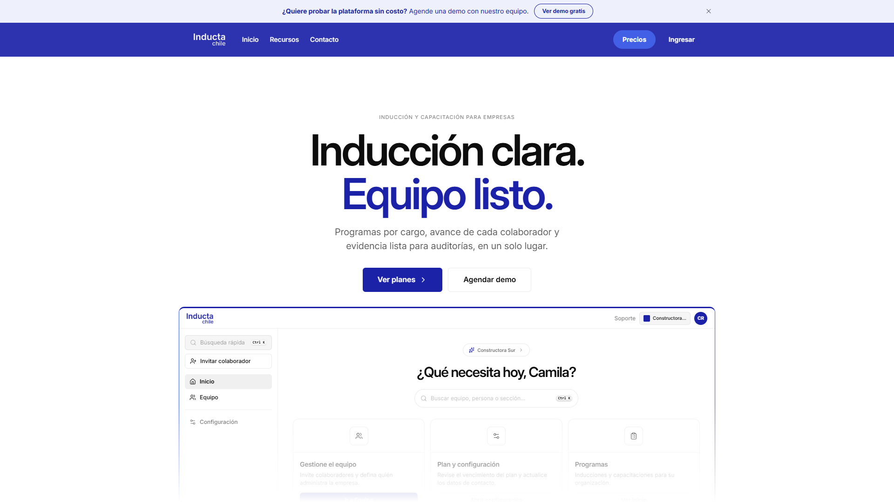
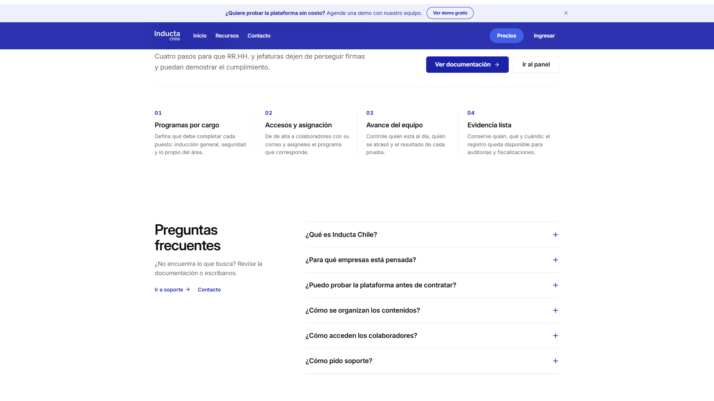
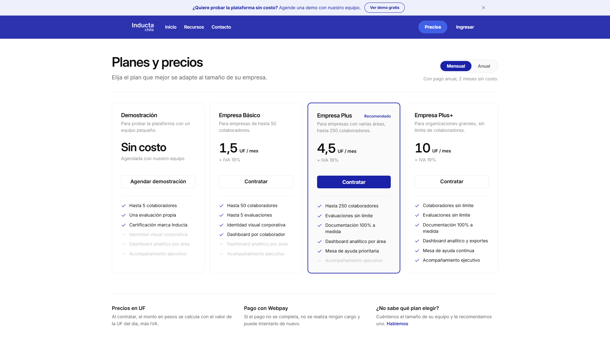
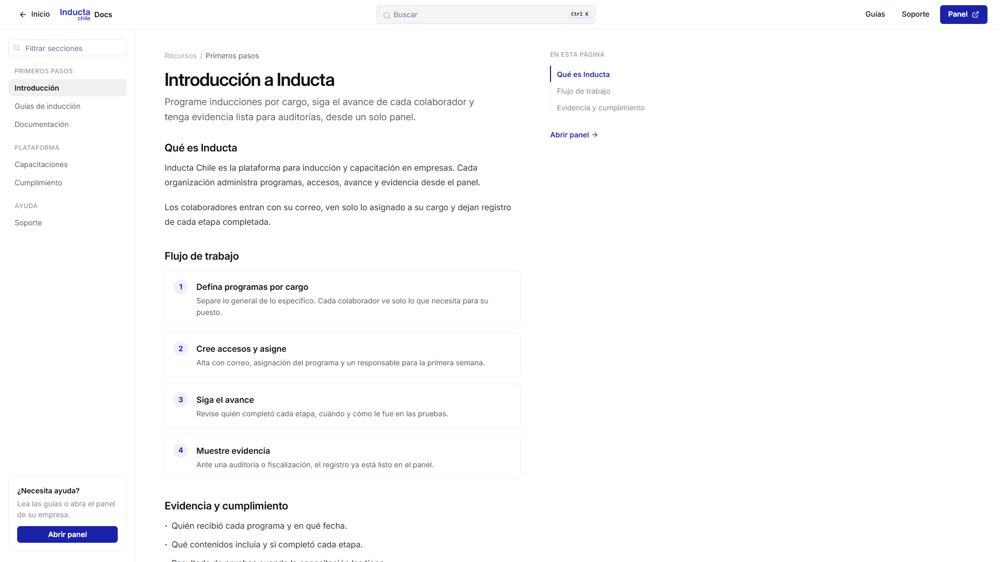
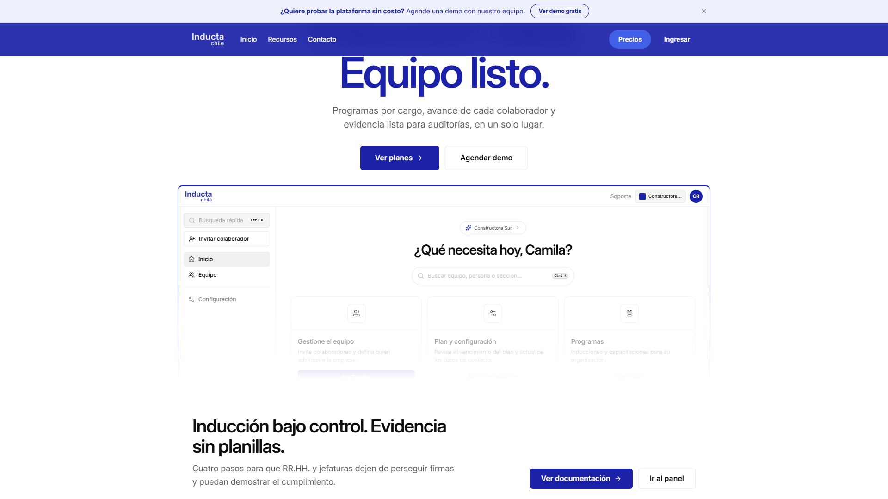
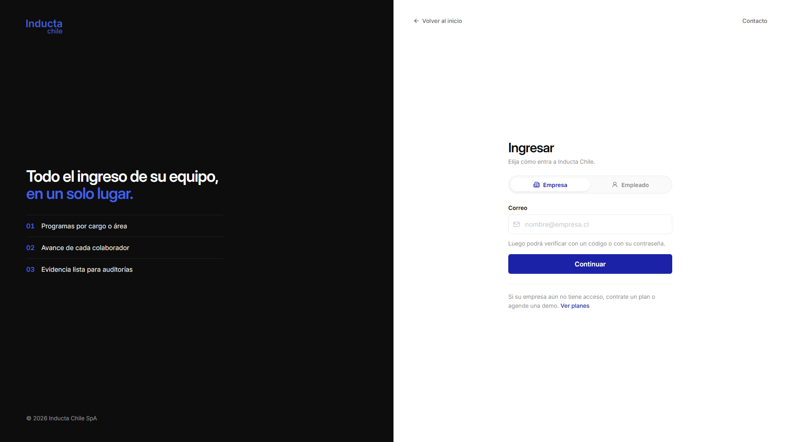
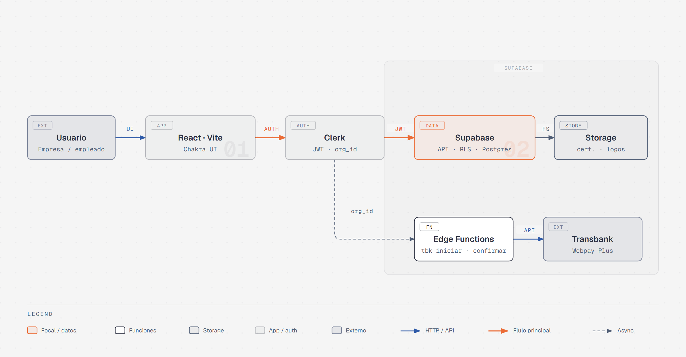
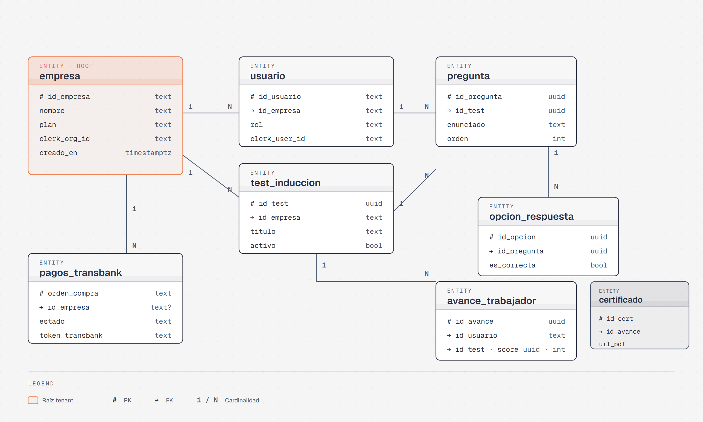
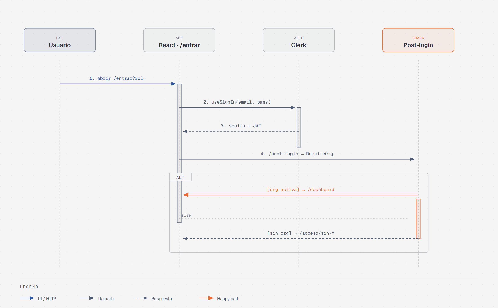
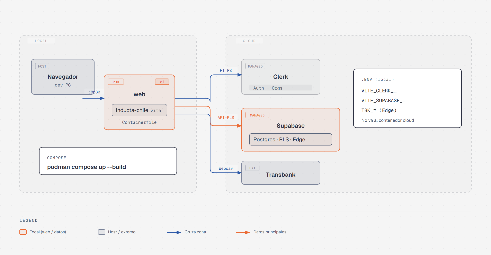

<p align="center">
  
</p>

<h1 align="center">Inducta Chile</h1>

<p align="center">
  <strong>Plataforma SaaS de inducción y capacitación corporativa</strong><br>
  Proyecto de Título · Ingeniería en Informática · Duoc UC — San Joaquín
</p>

<p align="center">
  <a href="https://github.com/Poison-CL/proyecto-titulo-inducta"></a>
</p>

<p align="center">
  
  
  
  
  
  
  
  
</p>

<p align="center">
  <a href="#sobre-el-proyecto">Proyecto</a> ·
  <a href="#capturas-del-sistema">Capturas</a> ·
  <a href="#qué-incluye-hoy">Funcionalidades</a> ·
  <a href="#equipo">Equipo</a> ·
  <a href="#stack-tecnológico">Stack</a> ·
  <a href="#inicio-rápido">Inicio rápido</a> ·
  <a href="#arquitectura">Arquitectura</a>
</p>

---

## Sobre el proyecto

**Inducta Chile** es una plataforma **SaaS multi-tenant** para digitalizar el onboarding y la capacitación del personal en empresas chilenas.

Centraliza programas de inducción por cargo, el avance de cada colaborador, la evidencia para auditorías y los planes comerciales con pago vía Transbank (precios en UF). El acceso se separa entre perfiles de **empresa** y **empleado**, con organizaciones de Clerk y datos en Supabase.

| Objetivo | Descripción |
| --- | --- |
| Ordenar | Inducciones y capacitaciones por cargo, área o normativa |
| Trazar | Quién completó cada etapa y en qué fecha |
| Evidenciar | Registro listo para auditoría y fiscalización |
| Monetizar | Suscripciones B2B con Webpay Plus |

---

## Capturas del sistema

Capturas de la app en desarrollo.

### Sitio público

<p align="center">
  
</p>
<p align="center"><sub>Inicio: hero, marca y vista previa del panel</sub></p>

<p align="center">
  
</p>
<p align="center"><sub>Cómo funciona: programas, accesos, avance y evidencia</sub></p>

<p align="center">
  
</p>
<p align="center"><sub>Planes: Demostración, Empresa Básico, Plus y Plus+ (UF + IVA)</sub></p>

### Hub de documentación

<p align="center">
  
</p>
<p align="center"><sub>Docs: búsqueda, secciones (Introducción, Guías, Documentación, Soporte) y TOC</sub></p>

### Panel e ingreso

<p align="center">
  
</p>
<p align="center"><sub>Panel empresa: shell con sidebar, búsqueda rápida (Ctrl K) y cards de acción</sub></p>

<p align="center">
  
</p>
<p align="center"><sub>Ingreso: rol Empresa / Empleado y correo vía Clerk</sub></p>

---

## Qué incluye hoy

### Sitio marketing

- Home con hero, mockup del panel, sección **Cómo funciona** (4 pasos) y FAQ
- **Hub de recursos** (`/recursos`) estilo documentación: búsqueda, tabs y artículos
- **Precios** mensuales/anuales en UF, contratación y resultados de pago Webpay
- Contacto y soporte público

### Acceso y panel

- Login custom **Empresa / Empleado** (`/entrar`) con Clerk Organizations
- Post-login y pantallas de ayuda si falta empresa o membresía
- Panel empresa (`/dashboard`): Inicio, Equipo, Configuración
- Shell compartido: topbar, sidebar, búsqueda del panel, cards de acción
- Panel admin de plataforma (`/admin`): resumen, tickets, empresas, pagos, usuarios

### Rutas principales

| Ruta | Descripción |
| --- | --- |
| `/` | Home marketing |
| `/precios` · `/contratar` | Planes y contratación |
| `/recursos/*` | Hub de docs, guías y soporte |
| `/entrar` | Ingreso (empresa o empleado) |
| `/dashboard` | Panel de la organización |
| `/dashboard/equipo` | Invitaciones y roles |
| `/dashboard/configuracion` | Plan y datos de contacto |
| `/admin/*` | Administración de la plataforma |

Código de la app: [Desarrollo_Proyecto/inducta-chile/README.md](Desarrollo_Proyecto/inducta-chile/README.md)

---

## Equipo

<table>
  <tr>
    <td width="50%" align="center" valign="top">
      <a href="https://github.com/Poison-CL">
        
      </a>
      <br><br>
      <strong><a href="https://github.com/Poison-CL">Mateo Martínez Gijón</a></strong>
      <br>
      <sub>@Poison-CL</sub>
      <br><br>
      Fullstack
      <br>
      <sub>React · Vite · Chakra UI · Supabase · Flujos de acceso · Panel y sitio</sub>
      <br><br>
      <a href="https://github.com/Poison-CL"></a>
      <a href="https://mateo-dev-seven.vercel.app/"></a>
    </td>
    <td width="50%" align="center" valign="top">
      <a href="https://github.com/haelfert-ux">
        
      </a>
      <br><br>
      <strong><a href="https://github.com/haelfert-ux">Hans Elfert</a></strong>
      <br>
      <sub>@haelfert-ux</sub>
      <br><br>
      Fullstack
      <br>
      <sub>Supabase · RLS · Clerk · Transbank · Edge Functions</sub>
      <br><br>
      <a href="https://github.com/haelfert-ux"></a>
    </td>
  </tr>
</table>

<p align="center">
  <sub>
    <strong>Institución:</strong> Duoc UC — Sede San Joaquín<br>
    <strong>Carrera:</strong> Ingeniería en Informática<br>
    <strong>Asignatura:</strong> Capstone / Portafolio de Título (PTY4614)
  </sub>
</p>

---

## Stack tecnológico

| Capa | Tecnología |
| --- | --- |
| Frontend | React 19, Vite 8, Chakra UI, React Router 7, Framer Motion / Motion |
| Autenticación | Clerk (organizaciones, roles, login custom) |
| Datos | Supabase (PostgreSQL, RLS, Storage, Edge Functions) |
| Pagos | Transbank Webpay Plus |
| Contenedor | Podman + Compose |

---

## Estructura del repositorio

```text
proyecto-titulo-inducta/
├── assets/
│   ├── diagrams/              # Arquitectura, modelo de datos, auth, deploy
│   ├── screenshots/           # Capturas del sistema (README)
│   └── logo-oficial.png
├── Desarrollo de Documentacion/   # Análisis, guías y requisitos
├── Desarrollo_Proyecto/
│   └── inducta-chile/         # App web (Vite) + Supabase + Podman
├── Fase 1/                    # Evidencias académicas Capstone
└── README.md
```

---

## Desarrollo de Documentación

La carpeta [`Desarrollo de Documentacion/`](Desarrollo%20de%20Documentacion/) concentra el trabajo previo y paralelo al código: problema, producto, backlog y guías para levantar el entorno.

### Documentos de análisis y producto

| # | Documento | Contenido |
| --- | --- | --- |
| 01 | [Análisis del Caso](Desarrollo%20de%20Documentacion/01%20Analisis%20del%20Caso.docx) | Problema, contexto y oportunidad |
| 02 | [Squad y responsabilidades](Desarrollo%20de%20Documentacion/02%20Squad%20y%20responsabilidades.docx) | Roles y división del trabajo |
| 03 | [Mapa Mental](Desarrollo%20de%20Documentacion/03%20Mapa%20Mental.docx) | Dominios y conceptos |
| 04 | [Mapa de Actores](Desarrollo%20de%20Documentacion/04%20Mapa%20de%20Actores.docx) | Empresa, trabajador, Inducta, externos |
| 05 | [Visión del Proyecto y 4 pilares](Desarrollo%20de%20Documentacion/05%20Vision%20del%20Proyecto%20y%204%20pilares.docx) | Dirección del producto |
| 06 | [Épicas](Desarrollo%20de%20Documentacion/06%20Epicas.docx) | Bloques de funcionalidad |
| 07 | [Historias de Usuario](Desarrollo%20de%20Documentacion/07%20Historias%20de%20Usuario.docx) | Historias para desarrollo |
| 08 | [Impact Mapping](Desarrollo%20de%20Documentacion/08%20Impact%20Mapping.docx) | Impacto por actor / objetivo |
| 09 | [Product Backlog Priorizado](Desarrollo%20de%20Documentacion/09%20Product%20Backlog%20Priorizado.docx) | Orden de entrega |
| 10 | [User Story Mapping](Desarrollo%20de%20Documentacion/10%20User%20Story%20Mapping.docx) | Flujo de punta a punta |
| 11 | [Retrospectiva del proyecto](Desarrollo%20de%20Documentacion/11%20Retrospectiva%20del%20proyecto.docx) | Aprendizajes |

### Guías técnicas

| Documento | Contenido |
| --- | --- |
| [requirements.txt](Desarrollo%20de%20Documentacion/requirements.txt) | Node ≥ 20, npm ≥ 10, Podman ≥ 5 |
| [INSTALACION-PODMAN.md](Desarrollo%20de%20Documentacion/INSTALACION-PODMAN.md) | Demo con Podman Compose |
| [CLERK-EMPRESA-EMPLEADO.md](Desarrollo%20de%20Documentacion/CLERK-EMPRESA-EMPLEADO.md) | Login, Organizations, guards |
| [README de la app](Desarrollo_Proyecto/inducta-chile/README.md) | Setup npm/Podman y estructura de `src/` |

---

## Inicio rápido

Guía detallada: [INSTALACION-PODMAN.md](Desarrollo%20de%20Documentacion/INSTALACION-PODMAN.md)

### Requisitos

- Node.js 20 o superior
- [Podman Desktop](https://podman-desktop.io/) (demo en `:8080`)
- Cuentas de [Clerk](https://dashboard.clerk.com) y [Supabase](https://supabase.com/dashboard)
- Orígenes permitidos en Clerk: `http://localhost:5173` y `http://localhost:8080`

### 1. Entrar a la app

```powershell
cd Desarrollo_Proyecto\inducta-chile
```

### 2. Variables de entorno

```powershell
copy .env.example .env
```

Completa en `.env`:

```env
VITE_CLERK_PUBLISHABLE_KEY=pk_test_...
VITE_SUPABASE_URL=https://xxxxx.supabase.co
VITE_SUPABASE_ANON_KEY=eyJ...
```

### 3A. Desarrollo local (npm)

```powershell
npm install
npm run dev
```

Aplicación en [http://localhost:5173/](http://localhost:5173/)

### 3B. Demo / deploy (Podman)

```powershell
podman machine start
podman compose up --build
```

Aplicación en [http://localhost:8080/](http://localhost:8080/)

```powershell
podman compose down
```

---

## Arquitectura

Archivos en `assets/diagrams/`.

### Vista de sistema

React → Clerk (JWT + `org_id`) → Supabase (API, RLS, Postgres), con pagos vía Edge Functions → Transbank y archivos en Storage.

<p align="center">
  
</p>

### Modelo de datos

Multi-tenant con `empresa` como raíz: usuarios, tests de inducción, preguntas, avances, certificados y pagos Transbank.

<p align="center">
  
</p>

### Autenticación (Empresa / Empleado)

1. La persona abre **Entrar** → `/entrar`.
2. Escribe correo; Clerk valida la cuenta.
3. Si hay sesión, va a `/post-login`.
4. Si pertenece a una **Organization**:
   - **Sí** → panel (`/dashboard`).
   - **No** → ayuda (`/acceso/sin-empresa` o `/acceso/sin-membresia`).

<p align="center">
  
</p>

Detalle: [CLERK-EMPRESA-EMPLEADO.md](Desarrollo%20de%20Documentacion/CLERK-EMPRESA-EMPLEADO.md)

### Despliegue local (Podman)

El contenedor `web` corre en la máquina del desarrollador; Clerk, Supabase y Transbank viven en la nube.

<p align="center">
  
</p>

---

## Repositorio

| Recurso | Enlace |
| --- | --- |
| Código fuente | [github.com/Poison-CL/proyecto-titulo-inducta](https://github.com/Poison-CL/proyecto-titulo-inducta) |
| Contribuciones | [@Poison-CL](https://github.com/Poison-CL) · [@haelfert-ux](https://github.com/haelfert-ux) |

---

## Licencia y uso

© 2026 Mateo Martínez Gijón y Hans Elfert.  
Todos los derechos reservados.  
Uso exclusivo académico del equipo del Proyecto de Título.  
Prohibida la copia, distribución o uso comercial sin autorización escrita de los autores.
